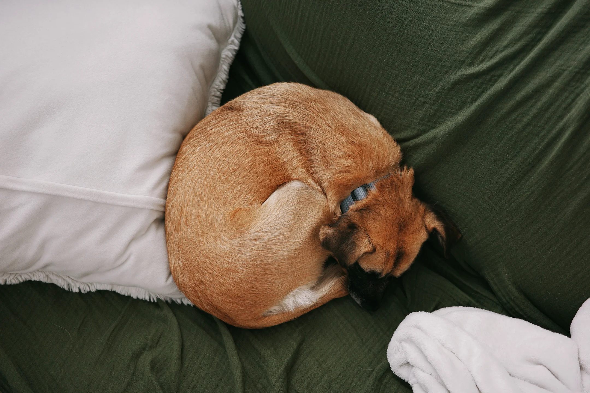

[Knowember](https://robertbirming.com/knowember/) is another little blogging challenge by Robert Birming. It’s all about learning more about the people behind the personal blogs. To quote him:

> The idea is simple: one page to let others know a bit more about yourself.

So if you also have a blog, please participate too!

Here’s my entry:

## A photo

I didn’t want to share a photo of myself but instead one of the newest member of our little family: Naida. Here seen posing as the world’s fluffiest croissant.

[We got her from a shelter back in spring](/welcome-naida) and she has done very well so far. Sometimes, I catch myself just watching her doing the most random things and that just makes me happy. She’s the best dog we could have wished for.

## Name or nickname

My name is Dominik but amongst friends, I usually go by “Domi”. It’s funny because whenever I talk to Americans, they usually abbreviate my name as “Dom”. That always confuses me because it makes me think of Vin Diesel’s character in Fast and the Furious.

I blog under my real name because I think doing that is more authentic than doing it under a pseudonym. And it allows me to share my work and build a reputation that becomes more valuable with every new artifact I post.

## Where in the world I blog from

99% of posts are written at my home in a town near Bern in Switzerland.

*[Photo via Unsplash](https://unsplash.com/photos/a-view-of-a-city-with-mountains-in-the-background-XxUjvngiWJU)*

If you’re ever in Switzerland, I highly recommend you visit this city. It’s internationally probably not as well known as Zurich or Geneva and has a completely different vibe. Of course I’m biased, but I like that it feels way calmer and friendlier than the other ones. When you visit, [write me an email](/hello) and I will tell you where you can get the best pizza in at least the whole country.

One other fun fact about Bern: It’s often named as the capital of Switzerland, mostly because the government and parliament building is here. But that’s wrong, [Switzerland doesn’t have an official capital](https://www.swissinfo.ch/eng/swiss-oddities/why-switzerland-hasnt-got-a-capital-city/89071876). There’s your trivia for the day, you’re welcome ;)

## What my blog is mostly about

Honestly, just about what sits on top of my mind. Mostly something about my personal life, running, writing, coding, minimalism, self-improvement and various other things.

Recently, I also started to write [a weekly newsletter](/newsletter) that is more tech-focused and mostly talks about the personal projects I’m working on. I’m also sharing interesting links I find during the week in there. So if you haven’t seen that yet, you can go read past issues in the archive. Or subscribe directly below, so you don’t miss the next issue.

That’s it for this challenge entry. I hope you got to know me a tiny bit better and that you also consider writing an entry yourself. I would love to read it!